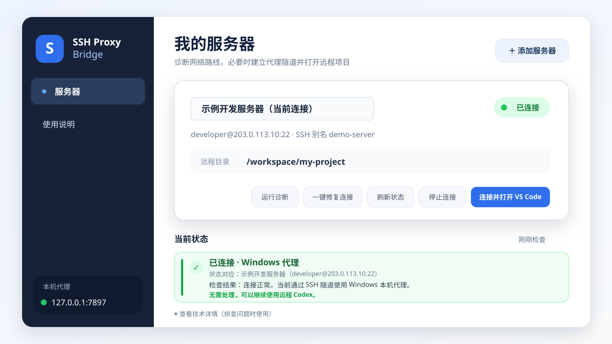
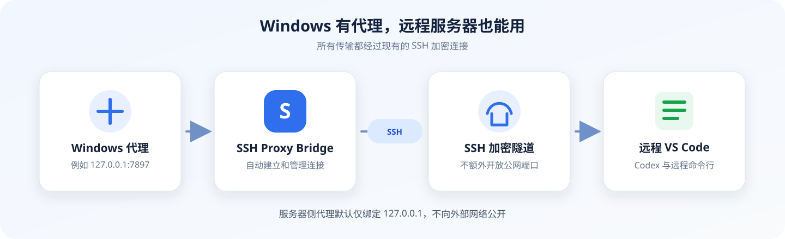

# SSH Proxy Bridge

[](https://github.com/zhourunnan1210/ssh-proxy-bridge/actions/workflows/ci.yml)
[](LICENSE)
[](https://github.com/zhourunnan1210/ssh-proxy-bridge/releases/latest)

**在 Windows 上管理远程 VS Code、Codex 网络和 SSH 代理隧道。**

你的 Windows 可以通过代理联网，但 SSH 服务器上的 Codex 连不上？

打开 SSH Proxy Bridge，填写服务器和本机代理信息，然后用 VS Code 打开指定的远程项目。可以单独检测服务器能否直连 Codex，也可以按需启用 Windows 代理隧道。

[**下载 Windows 版本**](https://github.com/zhourunnan1210/ssh-proxy-bridge/releases/latest) · [查看完整用户手册](USER_GUIDE.md)



> 上图为早期界面示意，使用示例服务器信息。当前操作见下方说明。

## 它帮你做什么

平时使用 VS Code Remote-SSH 时，程序和 Codex 扩展实际运行在远程服务器上。服务器不会自动使用你 Windows 电脑上的代理，所以可能无法访问需要的网络服务。

SSH Proxy Bridge 会：

- 从服务器直接检查 Codex 接口是否可达。
- 根据所选服务器的隧道状态，使用服务器直连或经 SSH 转发 Windows 本机代理。
- 将远程 Codex 的安装情况、账户服务可达性和登录状态显示在服务器页。
- 为服务器设置 Codex 等工具能够识别的直连或代理环境。
- 直接用 VS Code 打开你指定的远程项目目录。
- 检查并恢复已启用的受管隧道，保留用户主动关闭隧道的选择。
- 用醒目的彩色状态卡直接说明“是否正常、当前是哪台服务器、下一步做什么”，技术详情默认折叠。
- 保存多个服务器，下次只需选择服务器并点击连接。

## 三步开始使用

### 1. 下载并解压

打开 [Releases](https://github.com/zhourunnan1210/ssh-proxy-bridge/releases/latest)，下载名称类似下面的文件：

```text
SSH-Proxy-Bridge-v0.2.10-win-x64.zip
```

不要下载 GitHub 自动生成的 `Source code`。下载完成后右键选择“全部解压”，不要直接在压缩包预览窗口里运行程序。

### 2. 添加服务器

双击解压目录中的 `SshProxyBridge.exe`，然后点击“添加服务器”。你只需要准备：

- SSH 服务器地址、端口、用户名和密码。
- Windows 代理地址和端口，例如 `127.0.0.1:7897`。
- 希望 VS Code 打开的服务器目录，例如 `/workspace/my-project`。

第一次连接时，软件会让你确认服务器的 SSH 主机指纹。确认服务器身份后，程序会自动判断服务器支持公钥还是只支持密码网关，并配置对应的连接方式。

### 3. 连接并打开 VS Code

选择服务器并点击“连接并打开 VS Code”。代理隧道已启用时，应用会沿用代理路线。隧道关闭时，应用先检测直连。直连失败后，可以确认使用 Windows 代理再继续。

连接成功后，VS Code 会直接打开保存的远程目录。服务器页还有三项操作。

- **测试 Codex 直连**。仅检查服务器能否直接访问 Codex 接口。
- **代理隧道切换**。按钮显示当前隧道状态。可在同一按钮上启用、关闭或恢复隧道。
- **刷新状态**。在当前页面显示诊断结果，必要时恢复已启用的隧道或修复受管网络配置。刷新保留已关闭的隧道设置和现有 VS Code 窗口。

## 工作原理



启用代理时，SSH 反向隧道把服务器上的代理入口连接到 Windows 代理。服务器侧入口默认只监听 `127.0.0.1`。服务器直连使用服务器自身的网络。

## 使用前需要准备

- Windows 10/11 x64。
- 使用代理路线时，需要可用的 HTTP、HTTPS 或 mixed 代理软件。
- VS Code 和 Microsoft Remote - SSH 扩展。
- 一台可以通过 SSH 登录的 Linux 服务器。
- 服务器允许 TCP 端口转发。普通服务器建议允许公钥认证；只允许密码认证的云平台 SSH 网关也受支持。
- 需要在远程环境中使用的 VS Code 扩展，例如 Codex。

发行包已经包含 .NET 运行时，普通用户不需要另外安装 .NET SDK。

## 常见问题

<details>
<summary><strong>本机代理左侧的圆点是灰色</strong></summary>

先确认 Windows 代理软件已经启动，再检查填写的代理端口是否与代理软件一致。常见地址是 `127.0.0.1`，端口由你的代理软件决定。

</details>

<details>
<summary><strong>Windows 提示“未知发布者”</strong></summary>

当前版本没有商业代码签名证书。请只从本项目 Releases 页面下载，并根据[下载与文件校验说明](docs/DOWNLOAD_AND_VERIFY.md)核对 SHA-256 后再运行。

</details>

<details>
<summary><strong>SSH 初始化或登录失败</strong></summary>

检查服务器地址、SSH 端口、用户名和密码，并确认服务器允许 TCP 端口转发。软件会识别普通公钥服务器和只允许密码的云平台网关。密码网关需要勾选“保存密码”。连接失败时，可以用“刷新状态”查看具体环节。

</details>

<details>
<summary><strong>VS Code 已打开，但 Codex 仍然无法联网</strong></summary>

先点击“刷新状态”。如果现有 Codex 进程仍使用旧网络环境，卡片会提示保存工作后在 VS Code 中重新连接。刷新期间，现有 VS Code 窗口保持打开。

“当前状态”卡片标明了结果对应的服务器，并提供下一步建议。原始输出在默认折叠的“查看技术详情（排查问题时使用）”中。切换服务器时，应用会重新检查所选服务器。

</details>

<details>
<summary><strong>隧道会因为网络波动突然中断吗？</strong></summary>

电脑切换网络、休眠或连接重置时，SSH 隧道可能意外中断。已启用的隧道通过代理复验后，由独立进程持续监控。关闭 GUI 后，监控仍会在网络条件恢复时尝试重建隧道。在隧道按钮上主动关闭后，监控也会停止，直到你重新启用代理。

</details>

<details>
<summary><strong>为什么“远程 Codex 扩展”没有安装按钮？</strong></summary>

检测到所选服务器已安装扩展后，安装方式和安装按钮会隐藏。“无法访问”表示探测到的路线无法访问 ChatGPT 账户服务。如果只验证了远程 Shell，卡片会显示“扩展访问待确认”。检测到 Codex 进程、验证其路线可达且未发现登录凭据时，卡片显示“未登录”。

</details>

## 安全与隐私

- 服务器密码不会写入普通配置文件、日志或命令行。
- 选择“保存密码”时，密码保存在当前 Windows 用户的 Credential Manager。
- 对只允许密码认证的 SSH 网关，受控 AskPass Helper 会按需读取该凭据；运行配置、环境变量和临时文件中都没有明文密码。
- 首次连接需要人工确认服务器 SSH 主机指纹。
- 后续连接使用严格主机密钥检查，服务器身份变化时不会静默放行。
- 在普通服务器上，程序只追加自身缺失的 SSH 公钥，不覆盖服务器现有的 `authorized_keys`。
- 每个服务器使用独立配置和状态目录；普通服务器还使用独立受管 SSH Key。

更完整的安全模型和漏洞报告方式请参阅 [SECURITY.md](SECURITY.md)。

## 更多文档

- [完整用户手册](USER_GUIDE.md)：界面说明、服务器管理、诊断和常见问题。
- [下载与文件校验](docs/DOWNLOAD_AND_VERIFY.md)：SmartScreen、SHA-256 和完整解压说明。
- [开发说明](docs/development/DEVELOPMENT.md)：源码结构和本地开发。
- [贡献指南](CONTRIBUTING.md)：提交代码前需要遵守的约束。
- [产品需求文档](docs/development/PRODUCT_REQUIREMENTS.md)：产品设计和后续规划。
- [第三方组件](THIRD_PARTY_NOTICES.md)：开源依赖和许可证。

## 从源码运行

日常使用只双击仓库根目录的 `SshProxyBridge.exe`。开发者首次拉取源码或修改代码后，需要安装 .NET 8 SDK，然后在仓库目录执行：

```powershell
.\start-ssh-proxy-bridge-gui.cmd
```

这个脚本会构建最新便携版、更新根目录的唯一日常入口并启动它。不要运行 `app/**/bin`、`app/**/obj` 或旧 `release` 目录中的 EXE。

构建、测试和发行说明请查看[开发说明](docs/development/DEVELOPMENT.md)与[贡献指南](CONTRIBUTING.md)。

## 目录结构

| 目录或文件 | 用途 |
|---|---|
| `SshProxyBridge.exe` | 唯一日常 GUI 入口。 |
| `ssh-proxy-bridge.ps1` | GUI 调用的运行时连接引擎。 |
| `app/` | .NET 应用、核心库与自动化测试源码。 |
| `docs/` | 用户下载说明、图片和开发文档。 |
| `scripts/build/` | 打包与本地发布脚本。 |
| `scripts/legacy/` | 仅用于旧 `config.local.json` 的兼容工具。 |
| `release/` | 当前版本的便携包、ZIP 和校验文件。 |

## English summary

SSH Proxy Bridge is a Windows desktop application for remote Linux development. It tests Codex reachability, manages an optional SSH reverse tunnel to the Windows proxy, and opens the selected folder with VS Code Remote-SSH.

## 声明

SSH Proxy Bridge 是独立的开源项目，与 Microsoft 或 OpenAI 没有关联，也未获得其认可或背书。VS Code、Remote-SSH、OpenAI 和 Codex 是其各自权利人的商标或产品名称。

## License

[MIT](LICENSE) © 2026 SSH Proxy Bridge contributors.
